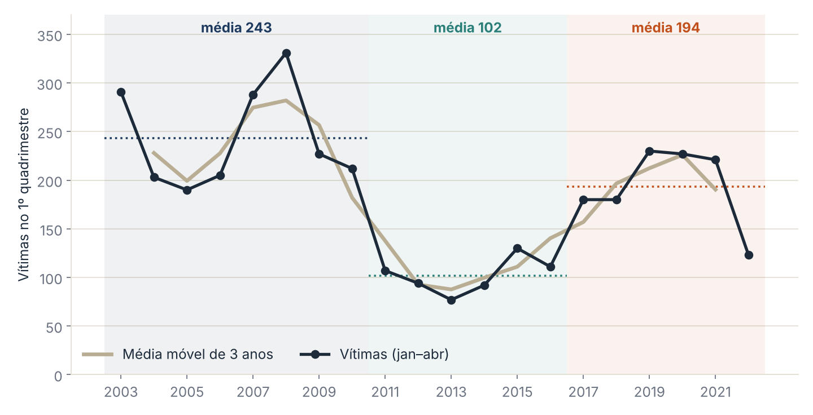

# Vítimas de auto de resistência no Rio de Janeiro (2003–2022)

   

**Autor:** Matheus Gomes da Costa · **Curso:** Bacharelado em Sistemas de Informação, 6º período
**Disciplina:** Linguagem de Programação (Análise e Visualização de Dados com Python) · **Instituição:** _[preencher]_ · **Semestre:** 2026.2

📄 **Artigo (GitHub Pages):** `https://matheusg0mes.github.io/VItimas-de-auto-de-resistencia/`

## Resumo executivo

Análise reprodutível da série oficial de vítimas de auto de resistência (homicídio decorrente de oposição à intervenção policial) no Município do Rio de Janeiro, no **1º quadrimestre de cada ano, de 2003 a 2022**. O pipeline em Python higieniza e valida a Tabela 2300 do Data.Rio, calcula métricas derivadas e comunica os resultados em um artigo HTML interativo.

Principais achados (descritivos, 20 observações):

- **Sem tendência linear detectável** (R² = 0,13; p = 0,118). A série se organiza em **três patamares**: média de 243 vítimas (2003–2010), 102 (2011–2016) e 194 (2017–2022).
- Pico em **2008 (331)** e vale em **2013 (77)**, queda de 76,7% entre eles.
- A taxa por 100 mil habitantes caiu de 4,96 para 1,81; **≈86% dessa queda vem da redução do número de vítimas**, não do crescimento populacional (+15,6%).



**Palavras-chave:** auto de resistência · letalidade policial · Rio de Janeiro · análise exploratória de dados · ciência aberta

## Fonte dos dados brutos

- Data.Rio — **Tabela 2300**: _Vítimas de auto de resistência, diferenças em relação ao mesmo quadrimestre do ano anterior, taxa por cem mil habitantes e média mensal, 1º quadrimestre, MRJ, 2003–2022_ — <https://www.data.rio/> _(colar aqui o link permanente da tabela)_
- Dados originais: Instituto de Segurança Pública (ISP-RJ) — <http://www.ispdados.rj.gov.br/> (consulta do IPP em 24/05/2022).
- Cópia do arquivo original: [`data/raw/tabela_2300_vitimas_auto_resistencia.xls`](data/raw/tabela_2300_vitimas_auto_resistencia.xls).

## Estrutura do repositório

```
VItimas-de-auto-de-resistencia/
├── README.md
├── LICENSE                     # MIT (código) + CC-BY 4.0 (dados e texto)
├── requirements.txt            # versões fixadas
├── .gitignore
├── data/
│   ├── raw/                    # .xls original, intocado
│   ├── processed/              # .csv.gz, .json, resumo_estatistico.json, etl_log.json
│   └── data_dictionary.md      # dicionário de variáveis (FAIR)
├── notebooks/
│   └── analise_exploratoria.ipynb
├── src/
│   ├── __init__.py
│   ├── etl.py                  # ingestão, limpeza, validação e métricas
│   └── figures.py              # figuras Plotly (interativas) e PNG (estáticas)
└── docs/                       # artigo publicado via GitHub Pages
    ├── index.html
    └── assets/                 # charts.js, fig*.png, vendor/plotly.min.js
```

## Como reproduzir

```bash
git clone https://github.com/matheusg0mes/VItimas-de-auto-de-resistencia.git
cd VItimas-de-auto-de-resistencia
python -m venv .venv && source .venv/bin/activate     # Windows: .venv\Scripts\activate
pip install -r requirements.txt

python -m src.etl          # data/raw -> data/processed (+ log de rastreabilidade)
python -m src.figures      # gera docs/assets/charts.js e fig*.png
jupyter lab notebooks/analise_exploratoria.ipynb
```

Para ver o artigo localmente, abra `docs/index.html` no navegador (funciona sem servidor).

## Publicação no GitHub Pages

_Settings → Pages → Build and deployment → Source: **Deploy from a branch** → Branch: `main`, pasta **`/docs`** → Save._

## Princípios FAIR

| | Como é atendido |
|---|---|
| **Findable** | Este README, palavras-chave, link da fonte, autoria e disciplina no cabeçalho dos artefatos. |
| **Accessible** | Repositório público; scripts sem credenciais; artigo servido via GitHub Pages, responsivo. |
| **Interoperable** | [`data/data_dictionary.md`](data/data_dictionary.md); dados em `.csv.gz` e `.json`. |
| **Reusable** | [`LICENSE`](LICENSE) (MIT + CC-BY 4.0); `requirements.txt` com versões fixadas; ETL com log de rastreabilidade. |

## Limitações

Apenas o 1º quadrimestre e apenas o município; 20 observações de uma série agregada (análise descritiva, não causal); classificação policial provisória; valor de 2022 possivelmente revisado desde a coleta.

## Licença e citação

Código: **MIT**. Dados processados, texto e figuras: **CC-BY 4.0**.

> COSTA, M. G. **Duas décadas de vítimas de auto de resistência no Rio de Janeiro (2003–2022)**. Trabalho de conclusão de disciplina, 2026. Disponível em: <https://github.com/matheusg0mes/VItimas-de-auto-de-resistencia>.
